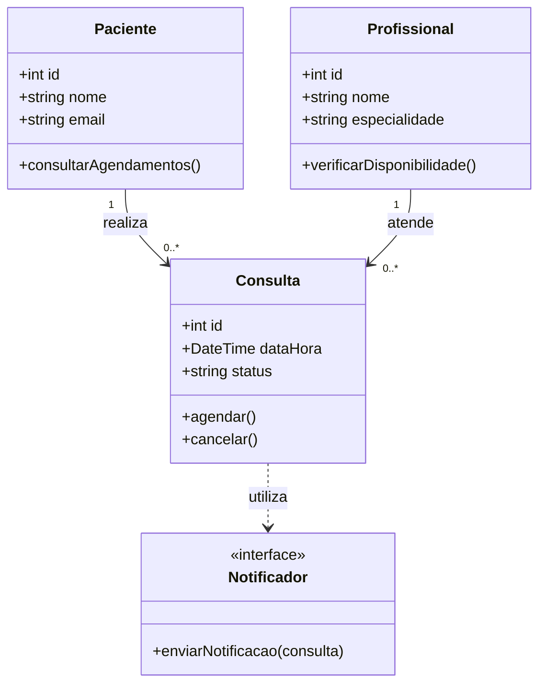

# Modelagem — Sistema de Agendamento de Consultas

## 1. Domínio escolhido

O sistema de agendamento de consultas permite cadastrar pacientes e profissionais, registrar consultas e enviar notificações sobre os agendamentos.

## 2. Diagrama de classes

## 3. Responsabilidades das classes

### Paciente

Representa a pessoa que solicita consultas. Mantém seus dados cadastrais e permite consultar seus agendamentos.

### Profissional

Representa o profissional responsável pelos atendimentos. Mantém informações como nome e especialidade e permite verificar a disponibilidade para consultas.

### Consulta

Representa um agendamento entre um paciente e um profissional. Controla a data, o horário e o status da consulta, além das operações de agendamento e cancelamento.

### Notificador

Define um contrato para o envio de notificações relacionadas às consultas. A implementação concreta pode utilizar e-mail ou outro meio de comunicação.

## 4. Aplicação do princípio SRP

O princípio da Responsabilidade Única (SRP) estabelece que uma classe deve ter um único motivo para mudar.

Neste modelo, cada classe possui uma responsabilidade específica: Paciente cuida dos dados do paciente, Profissional representa o responsável pelo atendimento, Consulta gerencia o agendamento e Notificador define o contrato para notificações.

Assim, mudanças no envio de mensagens não exigem modificar as regras de agendamento da classe Consulta.

## 5. Aplicação do princípio DIP

O princípio da Inversão de Dependência (DIP) orienta que módulos de alto nível dependam de abstrações, e não diretamente de implementações concretas.

A classe Consulta utiliza o contrato Notificador, em vez de depender diretamente de um serviço específico de e-mail. Dessa forma, diferentes implementações podem ser utilizadas sem alterar as regras de agendamento.

Essa separação também facilita testes, pois uma implementação simulada de Notificador pode ser utilizada sem enviar mensagens reais.
